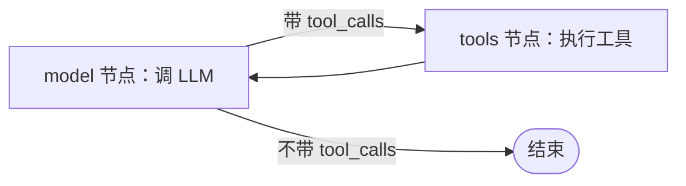

# LangChain 与 LangGraph 的区别：零件与引擎

>**日期**：2026年10月9日
>
>**作者**：Honlnk/鸿影

做 Agent 开发的人，几乎都绕不开这两个名字：LangChain 和 LangGraph。它们来自同一家公司，经常被放在同一句话里提及，但两者不是一回事——**一个是零件货架，一个是循环引擎**。这篇文章只讲一件事：把两者的分工拆开，说清楚各自管什么、不管什么。

---

## 一、先给结论

如果熟悉 agent harness 开发，这句话最直接：**一个 harness = 零件 + 引擎**。

- **LangChain 是零件**：模型客户端、Prompt 模板、消息类型体系、文档切分、向量检索……全是标准件，按需取用。它从头到尾不关心你的循环长什么样。
- **LangGraph 是引擎**：把"模型 ⇄ 工具"的循环变成一张显式的图，并围绕这张图提供每步自动 checkpoint、任意点挂起续跑、子图多 Agent 编排、时间旅行调试。

两者的关系是：**LangChain 给零件，LangGraph 给把零件组织起来的那套骨架**。LangGraph 可以单独使用，也常和 LangChain 的组件搭配用；但两者的抽象层级完全不同——一个在零件层，一个在引擎层。

---

## 二、LangChain：把 LLM 应用的公共模式抽成零件

LangChain 的故事得从 2022 年 10 月讲起——比 ChatGPT 发布还早一个月，当时 OpenAI 只有 completion API，连 chat 接口都没有。创始人 Harrison Chase 常去旧金山的 generative AI 聚会，看到早期玩家用 GPT-3 做的几个项目——Nat Friedman 的浏览器 Agent（NatBot）、"LLM 做数学"（LLM Math）、Self-Ask 这类检索式推理——背后有共同的模式，就把这些公共抽象抽出来做成了一个 side project，第一个 commit 只是一个 prompt 模板工具。它最初的价值主张叫 **composability（可组合性）**：把 LLM 和其他东西（数据、工具、另一个 LLM）"链"在一起。

所以 LangChain 最初的抽象就是"链（Chain）"：把 PromptTemplate、LLM、OutputParser 这些组件按固定顺序串成一条线性管道，比如"加载文档 → 切分 → 向量化 → 检索 → 拼 Prompt → 调模型 → 解析输出"。后来功能不断扩张（统一各家模型的 ChatModel 接口就是这个阶段加进来的），形成了今天的零件库：

- **ChatModel**：统一的模型调用接口（这是 chat API 出现后才加的抽象）
- **PromptTemplate / ChatPromptTemplate**：把系统提示词、few-shot 示例、动态变量组装成请求
- **输出解析**：把模型吐的文本结构化
- **文档加载与切分**：读 PDF、读网页、切成 chunk
- **向量检索集成**：对接向量库，做 embedding 与召回

这些抽象的共同点是：**它们是"能力"，不是"流程"**。LangChain 关心的是"怎么调模型""怎么检索""怎么拼 Prompt"，不关心"这些步骤按什么顺序执行、要不要循环、中途要不要暂停"。流程由你自己编排（链式管道是其中一种编排方式）。

---

## 三、LangGraph：把 Agent 的循环显式化

Agent 的本质是循环：**调模型 → 看要不要用工具 → 拿到结果再调模型 → 直到不再调工具**。这条路径是模型在运行时自己决定的，不是开发者提前写死的。链式抽象表达不了环——链是有向无环的，而循环要求绕回去再来一轮。

LangGraph 的核心抽象是**图（Graph）**，由三个要素构成：

- **State（状态）**：一个共享的状态对象（比如消息列表），贯穿整张图，每个节点读取它、更新它
- **Node（节点）**：计算单元——一次 LLM 调用、一次工具执行、一段普通函数都可以
- **Edge（边）**：流转规则，分固定边和条件边（运行时由函数看当前状态决定走哪条）

最经典的 Agent 图就两个节点一条回路：

把循环从代码控制流里拿出来、变成显式的图结构，框架就能接管这张图的执行，并围绕它提供四样手写循环很难做好的能力：

1. **每步自动 checkpoint**：每个超步（superstep）结束给状态拍快照，崩溃恢复、断点续跑、时间旅行调试都由此而来
2. **interrupt 挂起**：在任意节点暂停，等人审批后继续；挂起点连同状态一起持久化，**进程重启后还能从挂起点继续**——这是手写 Promise 挂起做不到的（刷新即丢）
3. **子图与多 Agent**：子代理作为子图编排，supervisor 分发、worker 执行有规范结构
4. **可视化调试**：图本身成为数据，可以直接画出来看

LangGraph 提供了一个预构建函数 `createReactAgent`，一行代码就能拼出上面的两节点一回路，外加 `pre_model_hook`（比如上下文压缩）等钩子。在 LangChain v1 里，这个经典循环还有了更高层的入口 `createAgent`——底层同样跑在 LangGraph 上，但包了一层更易用的 middleware 系统。

---

## 四、两者的分工边界

用一张表把边界划清楚：

| 维度 | LangChain | LangGraph |
|---|---|---|
| **抽象层级** | 零件层 | 引擎层 |
| **关心什么** | 怎么调模型、怎么检索、怎么拼 Prompt | 流程怎么流转、状态怎么传递、在哪里暂停恢复 |
| **执行形态** | 链（有向无环） | 图（允许有环） |
| **状态管理** | 无内置状态（链是无状态的） | State 贯穿全图，每步 checkpoint |
| **循环支持** | 不支持（链无法绕回去） | 核心能力（条件边 + 回边） |
| **人工介入** | 无 | interrupt（checkpoint 级挂起） |
| **持久化** | 无 | Checkpointer（自动快照） |
| **典型用途** | RAG、文档问答、一次性任务 | Agent、多步推理、人工审批流 |

一句话区分：**LangChain 关心"这一步做什么"，LangGraph 关心"做完这一步之后去哪"。**

---

## 五、什么时候用哪个

- **流程线性、一次调用就能解决的任务**：LangChain 甚至裸写 SDK 就够了。比如"检索 → 生成"的 RAG 问答，路径固定，不需要循环。
- **涉及多步循环决策、工具调用循环、多 Agent、需要审批或恢复执行**：用 LangGraph。链式抽象在这些场景下会撞墙。
- **混合场景**：两者搭配。用 LangChain 的零件（模型客户端、检索器）做节点内部的逻辑，用 LangGraph 的图组织节点之间的流转。这也是官方推荐的用法——LangChain v1（2025 年 10 月发布）里创建 Agent 的标准入口 `createAgent`，底层就是跑在 LangGraph 上。

官方这两年的重心明显转向了 LangGraph：2023 年夏天 LangChain 收到大量"高层抽象太黑盒、想改循环改不动"的反馈，于是 2024 年初推出 LangGraph，把"可控性"和"生产级运行时"作为两大支柱。原因不难理解：零件不稀缺（调 API 谁都会），**稀缺的是引擎层的工程化**——checkpoint、interrupt、循环控制这些东西每家自己做一遍，质量参差。框架的价值在引擎层，不在零件层。

---

## 六、收尾

分不清 LangChain 和 LangGraph 的时候，记住一个画面：**LangChain 是标准件货架，LangGraph 是把零件组装成 Agent 的引擎。** 前者关心"这一步做什么"，后者关心"做完这一步去哪、能不能绕回来、中途能不能停"。

两者的关系不是替代，是分工。这个生态后来的走向也印证了这一点：链式抽象表达不了循环，于是 LangGraph 补上了引擎层；到 LangChain v1，连"创建 Agent"这个最高层的入口都直接跑在了 LangGraph 之上——零件货架最终还是向引擎靠拢了。

---

## 参考与延伸

- [Reflections on Three Years of Building LangChain](https://www.langchain.com/blog/three-years-langchain)（Harrison Chase, 2025）——创始人回顾 LangChain 初心、LangGraph 动机与 v1 转向
- [The Point of LangChain — with Harrison Chase](https://www.latent.space/p/langchain)（Latent Space, 2023）——创始人复盘早期历史：2022 年 10 月构建、prompt 模板起家、composability 价值主张
- [LangChain 文档](https://python.langchain.com/docs/)——零件货架本体
- [LangGraph 文档](https://langchain-ai.github.io/langgraph/)——图引擎的官方说明
- [Building effective agents](https://www.anthropic.com/research/building-effective-agents)——Anthropic 对 Agent 与工作流的论述
